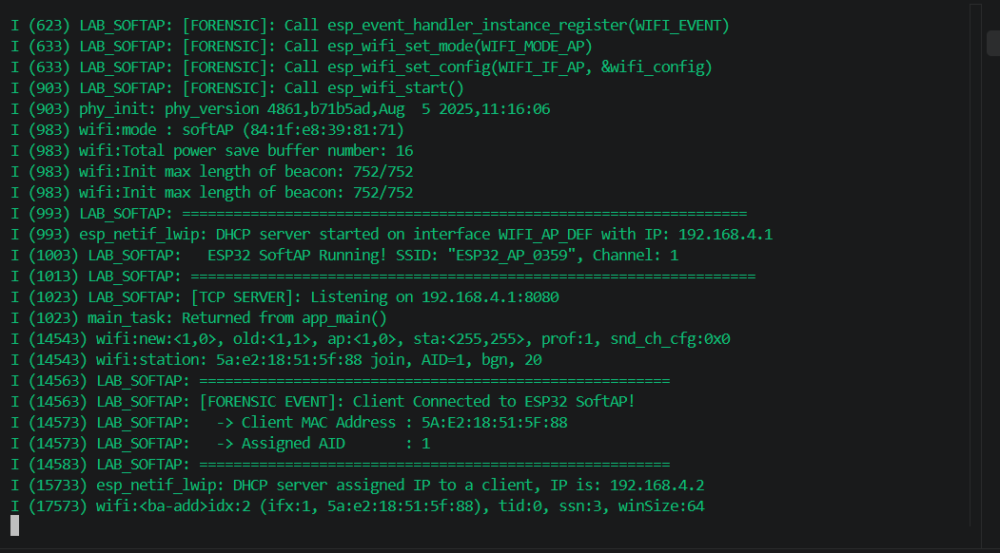
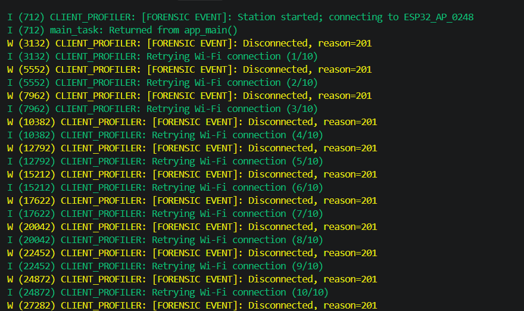
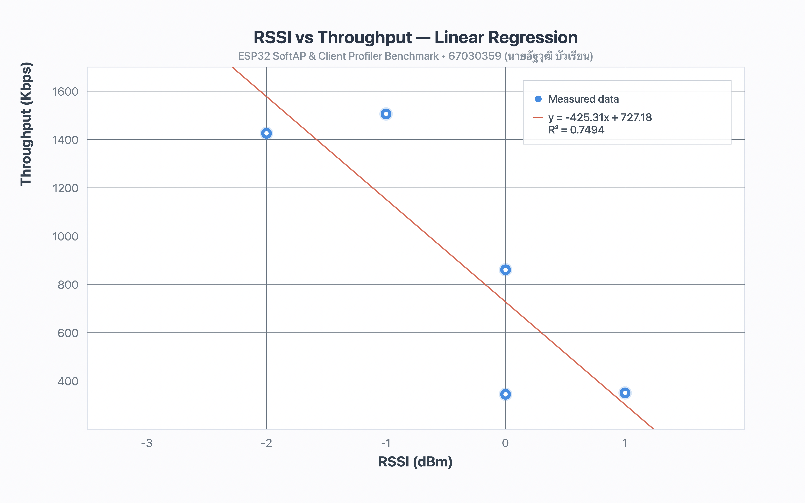
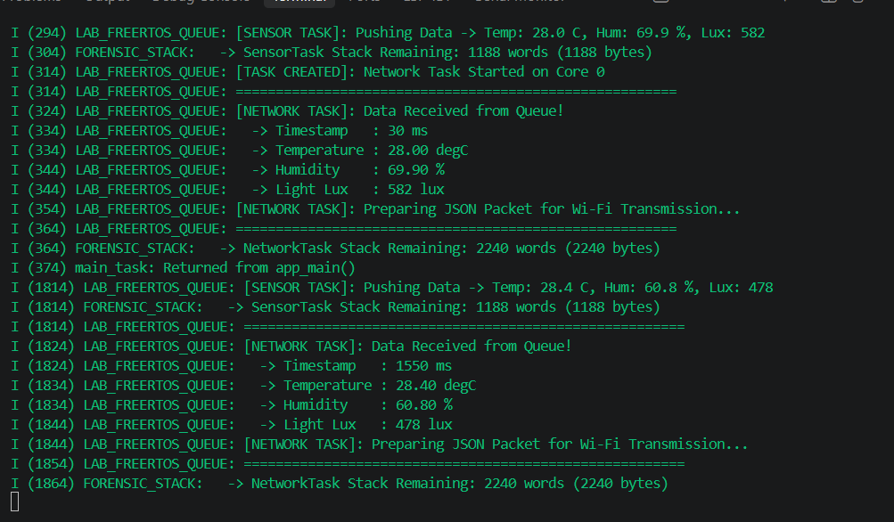
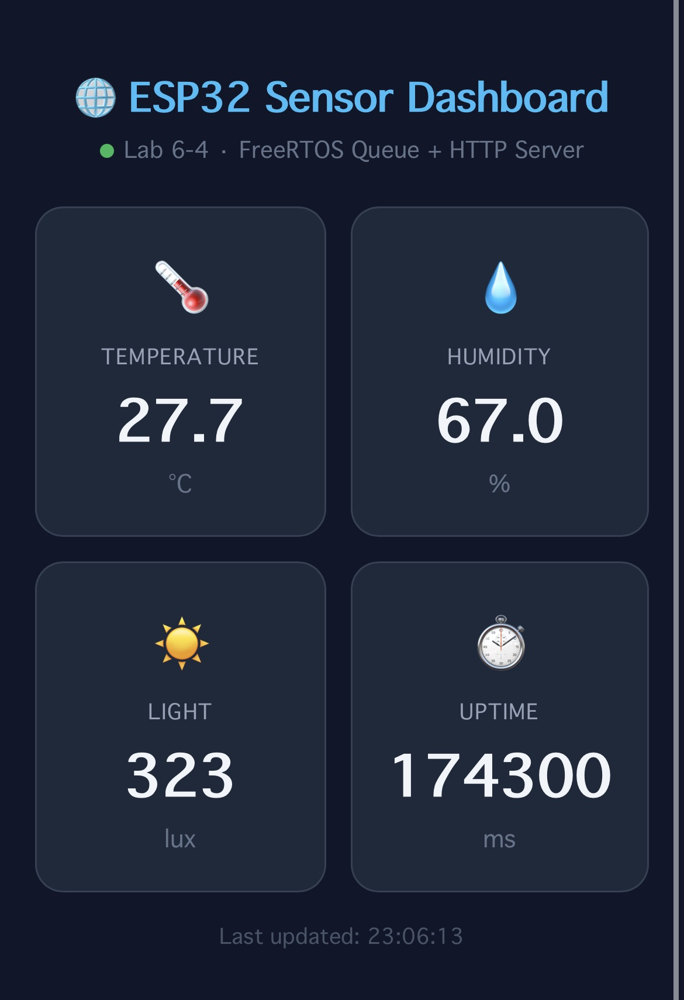
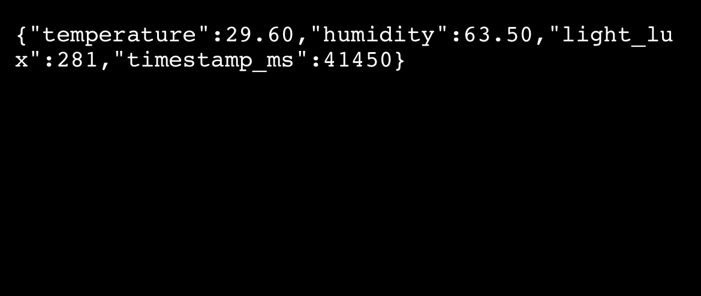
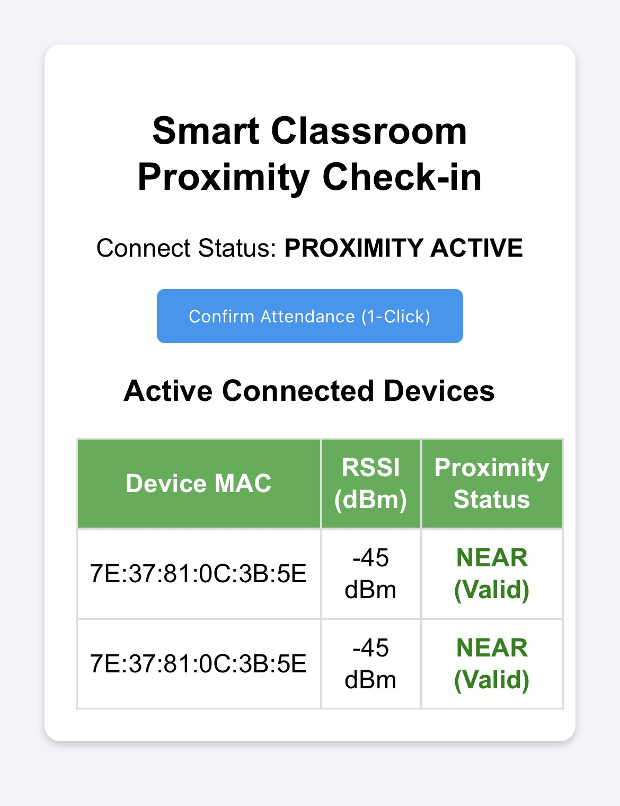

# Week 06 — ESP32 Wi-Fi SoftAP, RSSI Speed Profiler, FreeRTOS Sensor Queue & IoT Web Dashboard

**รหัสนักศึกษา:** 67030359  
**ชื่อ-นามสกุล:** นายอัฐวุฒิ บัวเรียน (Attawut Bualian)  
**วิชา:** ระบบสมองกลฝังตัวและการเชื่อมต่อเครือข่าย (Embedded Systems & IoT)  
**บอร์ดทดลอง:** ESP32 (ESP32-D0WD-V3) | **MAC Address:** `84:1F:E8:39:81:75`  
**โต๊ะปฏิบัติการ:** โต๊ะที่ 1  

---

## 📁 โครงสร้างโปรเจกต์ (Project Directory Structure)

```text
67030359/
├── README.md                                 # เอกสารแนะนำโปรเจกต์หลัก (ไฟล์นี้)
├── report.md                                 # รายงานผลการทดลองสัปดาห์ที่ 6 ฉบับสมบูรณ์
├── rssi_vs_throughput.png                    # กราฟวิเคราะห์ความสัมพันธ์ RSSI vs Throughput
├── images/                                   # โฟลเดอร์เก็บภาพผลการทดลองและหน้าจอ Dashboard
│   ├── lab61_softap.png
│   ├── lab62_profiler.png
│   ├── rssi_vs_throughput.png
│   ├── lab63_freertos.png
│   ├── lab64_dashboard.png
│   ├── lab64_api.png
│   └── lab65_dashboard.png
├── firebase_logs/                            # โฟลเดอร์เก็บไฟล์บันทึกผล Serial Log
│   ├── w06_1.log
│   ├── w06_2.log
│   ├── w06_3.log
│   ├── w06_4.log
│   └── w06_5.log
├── Lab6-1-Wi-Fi-SoftAP/                      # โครงงานแล็บ 6.1: โหมดกระจายสัญญาณ Wi-Fi SoftAP
├── Lab6-2-RSSI-Speed-Profiler/               # โครงงานแล็บ 6.2: วัดความแรงสัญญาณและประเมินความเร็ว
├── Lab6-3-FreeRTOS-Sensor-Queue/             # โครงงานแล็บ 6.3: การส่งข้อมูลเซนเซอร์ผ่านคิว FreeRTOS
├── Lab6-4-IoT-Sensor-Dashboard/              # โครงงานแล็บ 6.4: เว็บแดชบอร์ดและ RESTful API
└── Lab6-5-Proximity-Attendance/              # โครงงานแล็บ 6.5: ระบบเช็กชื่อเข้าเรียนอัตโนมัติด้วย RSSI
```

---

## 🧪 สรุปหัวข้อการทดลอง (Labs Overview)

| ลำดับแล็บ | โฟลเดอร์โปรเจกต์ | รายละเอียดและการทำงานหลัก | ไฟล์ Log อ้างอิง |
| :--- | :--- | :--- | :--- |
| **Lab 6.1** | `Lab6-1-Wi-Fi-SoftAP` | ตั้งค่า ESP32 เป็น Access Point (`ESP32_AP_67030359`) พร้อมเปิด DHCP Server แจก IP (`192.168.4.x`) | `firebase_logs/w06_1.log` |
| **Lab 6.2** | `Lab6-2-RSSI-Speed-Profiler` | วัดความแรงสัญญาณ (RSSI) เทียบกับความเร็วการรับส่งข้อมูล (Throughput) และประเมิน Packet Loss ในระยะต่างๆ | `firebase_logs/w06_2.log` |
| **Lab 6.3** | `Lab6-3-FreeRTOS-Sensor-Queue` | สร้าง Producer Task และ Consumer Task รับ-ส่งข้อมูลเซนเซอร์ผ่าน `QueueHandle_t` อย่างปลอดภัย | `firebase_logs/w06_3.log` |
| **Lab 6.4** | `Lab6-4-IoT-Sensor-Dashboard` | พัฒนา HTTP Web Server แสดงผลหน้าเว็บ Dashboard และเปิด RESTful API (`/api/sensors`) ในรูปแบบ JSON | `firebase_logs/w06_4.log` |
| **Lab 6.5** | `Lab6-5-Proximity-Attendance` | ระบบเช็กชื่อเข้าเรียนอัตโนมัติ (Proximity Attendance) ตรวจสอบระยะห่างจากค่า RSSI ($\ge -65\text{ dBm}$) | `firebase_logs/w06_5.log` |

---

## 🖼️ ภาพตัวอย่างผลการทดลอง (Screenshots Preview)

### 1. Lab 6.1 — Wi-Fi SoftAP Mode


### 2. Lab 6.2 — RSSI & Speed Profiler




### 3. Lab 6.3 — FreeRTOS Sensor Queue


### 4. Lab 6.4 — IoT Sensor Dashboard & JSON API




### 5. Lab 6.5 — Proximity Attendance Dashboard


---

## 🚀 วิธีการคอมไพล์และอัปโหลดโปรแกรม (Build & Flash Instructions)

เปิดใช้งานสภาพแวดล้อม **ESP-IDF (v5.x)** แล้วรันคำสั่งต่อไปนี้ในโฟลเดอร์ของแล็บที่ต้องการทดสอบ:

```bash
# 1. เข้าไปยังโฟลเดอร์ของแล็บที่ต้องการ (เช่น Lab 6.1)
cd Lab6-1-Wi-Fi-SoftAP

# 2. คอมไพล์โปรเจกต์
idf.py build

# 3. แฟลชลงบอร์ด ESP32 และเปิดหน้าต่าง Serial Monitor
idf.py -p <PORT> flash monitor
```
*(หมายเหตุ: แทนที่ `<PORT>` ด้วยพอร์ตของบอร์ด ESP32 เช่น `COM3` บน Windows หรือ `/dev/ttyUSB0` บน Linux/macOS)*