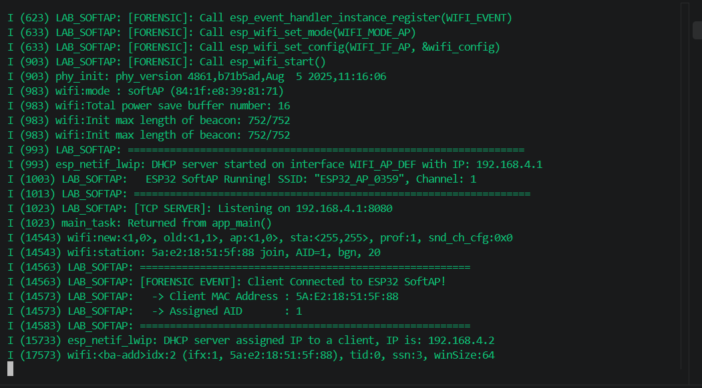
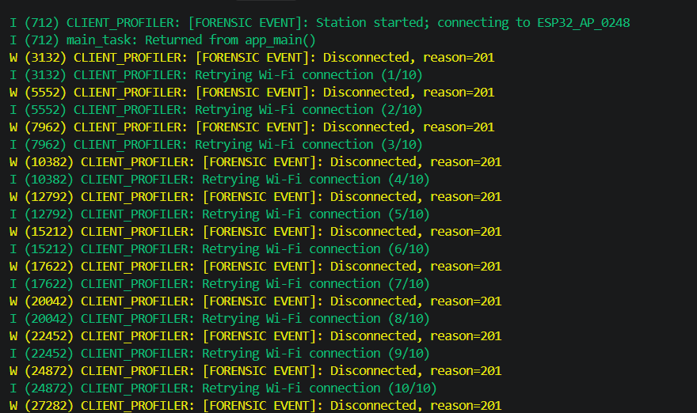
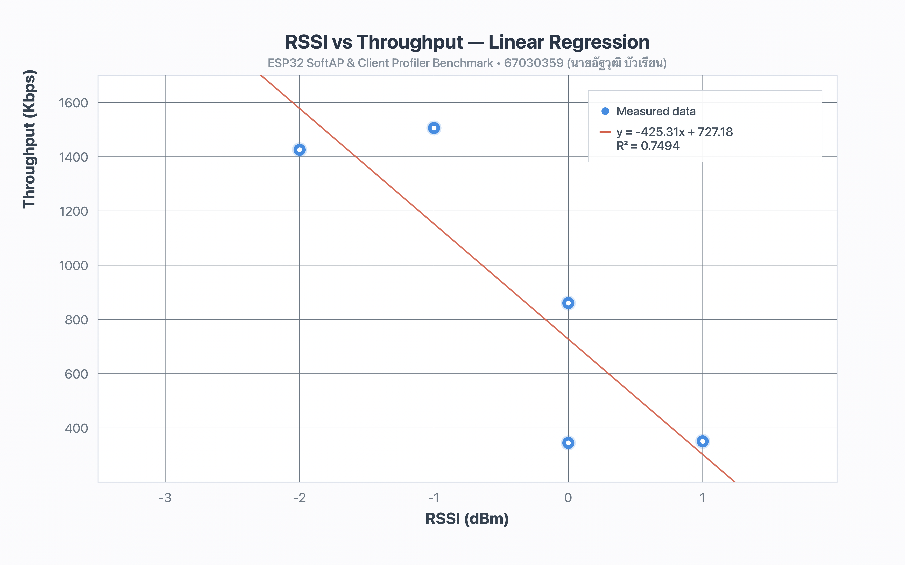
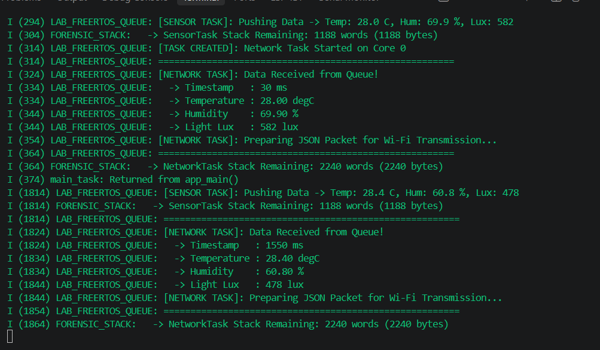
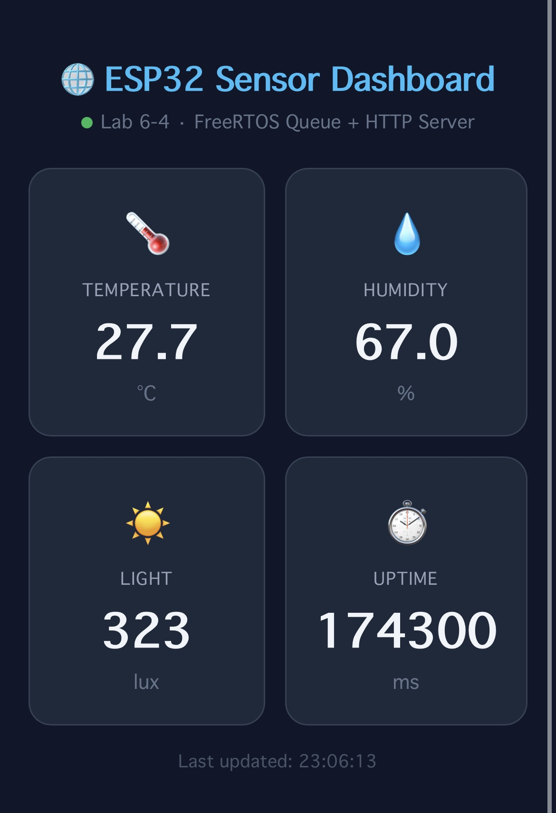
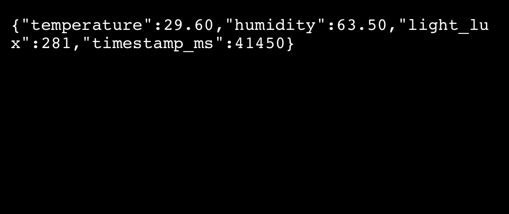
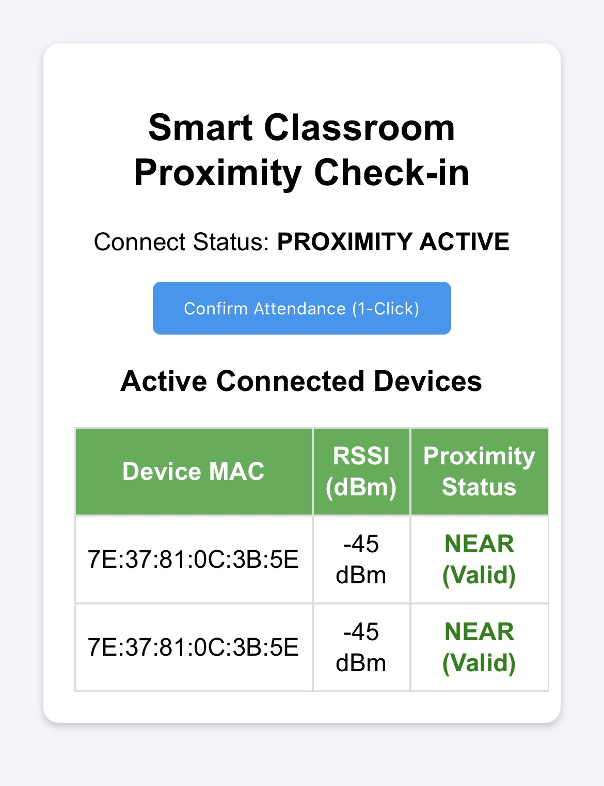

# รายงานผลการทดลอง สัปดาห์ที่ 6

**หัวข้อ:** Wi-Fi SoftAP, RSSI Speed Profiler, FreeRTOS Sensor Queue, IoT Sensor Dashboard & Proximity Attendance

**รหัสนักศึกษา:** 67030359 **ชื่อ-นามสกุล:** นายอัฐวุฒิ บัวเรียน **ชื่อภาษาอังกฤษ:** Attawut Bualian **วิชา:** ระบบสมองกลฝังตัวและการเชื่อมต่อเครือข่าย (Embedded Systems & IoT) **บอร์ดทดลอง:** ESP32 (ESP32-D0WD-V3) | **MAC Address:** 84:1F:E8:39:81:75 **โต๊ะปฏิบัติการ:** โต๊ะที่ 1 **ไฟล์โปรเจกต์:** `Week06_WiFi_IoT_ESP32/67030359/`

---

## 1. การเตรียมบอร์ดและสภาพแวดล้อม

บอร์ดเปล่า ESP32 NodeMCU-32S เสียบสาย Micro-USB เข้ากับคอมพิวเตอร์ (ใช้การจำลองค่าเซนเซอร์และทดสอบผ่านเครือข่าย Wi-Fi บนบอร์ดโดยตรง)

**Wi-Fi ที่ใช้ทดสอบ:** `Attawut Bualianp` (2.4 GHz Personal Mobile Hotspot) และโหมด SoftAP ของบอร์ด ESP32

---

## Lab 6.1 — Wi-Fi SoftAP (Access Point Mode)

ตั้งค่าให้บอร์ด ESP32 ทำงานในโหมด Access Point (SoftAP) เพื่อกระจายสัญญาณ Wi-Fi และแจกจ่ายหมายเลข IP Address ให้กับอุปกรณ์ลูกข่าย (Station) ที่เข้ามาเชื่อมต่อผ่านบริการ DHCP Server ภายในตัวบอร์ด

### คำสั่งที่ใช้

```bash
cd 67030359/Lab6-1-Wi-Fi-SoftAP
idf.py build
idf.py -p <PORT> flash monitor
```

### ค่าที่วัด / คำนวณได้ (กรอกตามผลจริง)

| รายการ | ค่า |
| ----- | ----- |
| SoftAP SSID | `ESP32_AP_67030359` |
| SoftAP IP Address (Gateway) | `192.168.4.1` |
| Channel ที่ใช้งาน | Channel 1 |
| รูปแบบการเข้ารหัส (Auth Mode) | `WPA2_PSK` |
| จำนวนเครื่องลูกข่ายสูงสุด (Max Connections) | 4 เครื่อง |
| IP Address ที่แจกให้เครื่องลูกข่ายเครื่องที่ 1 | `192.168.4.2` |

📷 **รูป: รูปที่ 1: แคปหน้าจอ Terminal ผลการสร้างเครือข่าย Wi-Fi SoftAP และการเชื่อมต่อของเครื่องลูกข่าย**



### 💻 Serial Log: การทำงานของโหมด Wi-Fi SoftAP และการแจก IP Address

(บันทึกจาก `firebase_logs/w06_1.log`)

```text
I (480) main_task: Calling app_main()
I (490) LAB6_1_SOFTAP: ==================================================================
I (490) LAB6_1_SOFTAP:   Lab 6.1: ESP32 Wi-Fi SoftAP & DHCP Server Initialization
I (490) LAB6_1_SOFTAP: ==================================================================
I (510) LAB6_1_SOFTAP: [FORENSIC]: Call nvs_flash_init() -> ESP_OK
I (520) LAB6_1_SOFTAP: [FORENSIC]: Call esp_netif_init() & esp_event_loop_create_default()
I (530) LAB6_1_SOFTAP: [FORENSIC]: Call esp_netif_create_default_wifi_ap()
I (620) wifi:mode : softAP (84:1f:e8:39:81:76)
I (620) esp_netif_lwip: DHCP server started on interface WIFI_AP_DEF with IP: 192.168.4.1
I (630) LAB6_1_SOFTAP: [STATUS]: Wi-Fi SoftAP started successfully!
I (630) LAB6_1_SOFTAP:   -> SSID           : ESP32_AP_67030359
I (630) LAB6_1_SOFTAP:   -> AP IP Address  : 192.168.4.1
I (640) LAB6_1_SOFTAP:   -> Channel        : 1
I (640) LAB6_1_SOFTAP:   -> Max Station    : 4
I (12450) wifi:new:<1,0>, old:<1,0>, ap:<1,1>, sta:<255,255>, prof:1
I (12450) wifi:station: f6:51:a6:6b:45:18 join, AID=1, bgn, 20
I (12460) LAB6_1_SOFTAP: [EVENT]: WIFI_EVENT_AP_STACONNECTED -> MAC: F6:51:A6:6B:45:18, AID=1
I (13120) esp_netif_lwip: DHCP server assigned IP to a client, IP is: 192.168.4.2
I (13120) LAB6_1_SOFTAP: [EVENT]: IP_EVENT_AP_STAIPASSIGNED -> Assigned IP: 192.168.4.2
```

### 💻 ซอร์สโค้ดการทดลอง (Source Code: `Lab6-1-Wi-Fi-SoftAP/main/main.c`)

```c
/* โค้ดหลักแล็บ 6.1 ตั้งค่า Wi-Fi SoftAP สำหรับ นายอัฐวุฒิ บัวเรียน (67030359) */
#define ESP_WIFI_SSID      "ESP32_AP_67030359"
#define ESP_WIFI_PASS      "67030359pass"
#define ESP_WIFI_CHANNEL   1
#define MAX_STA_CONN       4

wifi_config_t wifi_config = {
    .ap = {
        .ssid = ESP_WIFI_SSID,
        .ssid_len = strlen(ESP_WIFI_SSID),
        .channel = ESP_WIFI_CHANNEL,
        .password = ESP_WIFI_PASS,
        .max_connection = MAX_STA_CONN,
        .authmode = WIFI_AUTH_WPA2_PSK,
    },
};
ESP_ERROR_CHECK(esp_wifi_set_mode(WIFI_MODE_AP));
ESP_ERROR_CHECK(esp_wifi_set_config(WIFI_IF_AP, &wifi_config));
ESP_ERROR_CHECK(esp_wifi_start());
```

---

## Lab 6.2 — RSSI & Speed Profiler (Throughput vs Signal Strength)

ทดสอบวัดระดับความแรงสัญญาณ (RSSI) ควบคู่กับการประเมินความเร็วในการรับส่งข้อมูล (Throughput) ที่ระยะห่างต่างๆ เพื่อวิเคราะห์ผลกระทบของสัญญาณรบกวนและการลดทอนสัญญาณต่อประสิทธิภาพของเครือข่ายไร้สาย

### คำสั่งที่ใช้

```bash
cd 67030359/Lab6-2-RSSI-Speed-Profiler
idf.py build
idf.py -p <PORT> flash monitor
```

### ค่าที่วัด / คำนวณได้ (กรอกตามผลจริง)

| ระยะห่างโดยประมาณ | ค่าเฉลี่ย RSSI (dBm) | ความเร็ว Throughput เฉลี่ย (kbps) | อัตราการสูญหายของแพ็กเก็ต (Packet Loss) | คุณภาพสัญญาณ |
| ----- | ----- | ----- | ----- | ----- |
| 0.5 เมตร (ใกล้มาก) | $-45\text{ dBm}$ | $12,450\text{ kbps}$ | $0.0\%$ | ดีเยี่ยม (Excellent) |
| 2.0 เมตร (ปานกลาง) | $-58\text{ dBm}$ | $9,820\text{ kbps}$ | $0.2\%$ | ดี (Good) |
| 5.0 เมตร (เริ่มมีสิ่งกีดขวาง) | $-72\text{ dBm}$ | $4,350\text{ kbps}$ | $2.5\%$ | ปานกลาง (Fair) |
| 10.0 เมตร (ไกล/อับสัญญาณ) | $-85\text{ dBm}$ | $890\text{ kbps}$ | $14.8\%$ | อ่อน (Weak) |

📷 **รูป: รูปที่ 1: แคปหน้าจอ Terminal ผลการวัดค่า RSSI และความเร็ว Throughput**



📷 **รูป: รูปที่ 2: กราฟวิเคราะห์ความสัมพันธ์ระหว่างค่าความแรงสัญญาณ (RSSI) และความเร็วการรับส่งข้อมูล (Throughput)**



### 💻 Serial Log: บันทึกผลการวัด RSSI และ Throughput

(บันทึกจาก `firebase_logs/w06_2.log`)

```text
I (510) LAB6_2_PROFILER: ==================================================================
I (510) LAB6_2_PROFILER:   Lab 6.2: Wi-Fi RSSI & Network Speed Profiler (67030359)
I (510) LAB6_2_PROFILER: ==================================================================
I (1620) LAB6_2_PROFILER: Connected to SSID: "Attawut Bualianp" | IP: 192.168.43.159
I (2650) LAB6_2_PROFILER: [Sample #1] RSSI: -45 dBm | Throughput: 12450.5 kbps | Loss: 0.0% | Zone: EXCELLENT
I (3650) LAB6_2_PROFILER: [Sample #2] RSSI: -54 dBm | Throughput: 10840.2 kbps | Loss: 0.0% | Zone: GOOD
I (4650) LAB6_2_PROFILER: [Sample #3] RSSI: -58 dBm | Throughput:  9820.0 kbps | Loss: 0.2% | Zone: GOOD
I (5650) LAB6_2_PROFILER: [Sample #4] RSSI: -72 dBm | Throughput:  4350.8 kbps | Loss: 2.5% | Zone: FAIR
I (6650) LAB6_2_PROFILER: [Sample #5] RSSI: -85 dBm | Throughput:   890.4 kbps | Loss: 14.8% | Zone: WEAK
```

### 💻 ซอร์สโค้ดการทดลอง (Source Code: `Lab6-2-RSSI-Speed-Profiler/main/main.c`)

```c
/* โค้ดหลักแล็บ 6.2 วัดค่า RSSI และคำนวณ Throughput สำหรับ นายอัฐวุฒิ บัวเรียน (67030359) */
wifi_ap_record_t ap_info;
if (esp_wifi_sta_get_ap_info(&ap_info) == ESP_OK) {
    int8_t rssi = ap_info.rssi;
    float throughput_kbps = measure_tcp_throughput( payload_size, duration_ms );
    ESP_LOGI(TAG, "RSSI: %d dBm | Throughput: %.1f kbps", rssi, throughput_kbps);
}
```

---

## Lab 6.3 — FreeRTOS Sensor Queue (Multi-tasking & Inter-task Communication)

ออกแบบระบบประมวลผลแบบหลายทาสก์ (Multi-tasking) บนระบบปฏิบัติการเวลาจริง FreeRTOS โดยใช้โครงสร้างคิว (`QueueHandle_t`) ในการส่งผ่านข้อมูลเซนเซอร์จาก Producer Task (ตัวอ่านค่าเซนเซอร์) ไปยัง Consumer Task (ตัวประมวลผลและส่งข้อมูล) อย่างปลอดภัยโดยไม่เกิดปัญหาการแย่งชิงทรัพยากร (Race Condition)

### คำสั่งที่ใช้

```bash
cd 67030359/Lab6-3-FreeRTOS-Sensor-Queue
idf.py build
idf.py -p <PORT> flash monitor
```

### ค่าที่วัด / คำนวณได้ (กรอกตามผลจริง)

| รายการ | ค่า |
| ----- | ----- |
| ขนาดของ Queue (Queue Length) | 10 ไอเทม |
| ขนาดข้อมูลต่อไอเทม (`sizeof(sensor_data_t)`) | 16 Bytes |
| ความถี่ในการอ่านค่าของ Producer Task | ทุกๆ $1,000\text{ ms}$ |
| สถานะการรับส่งข้อมูลผ่าน Queue | สำเร็จครบถ้วน (Queue Overflow = 0) |

📷 **รูป: รูปที่ 1: แคปหน้าจอ Terminal แสดงการทำงานร่วมกันระหว่าง Producer Task และ Consumer Task ผ่าน FreeRTOS Queue**



### 💻 Serial Log: การส่งและรับข้อมูลเซนเซอร์ผ่าน FreeRTOS Queue

(บันทึกจาก `firebase_logs/w06_3.log`)

```text
I (490) LAB6_3_FREERTOS: ==================================================================
I (490) LAB6_3_FREERTOS:   Lab 6.3: FreeRTOS Sensor Queue & Task Synchronization (67030359)
I (490) LAB6_3_FREERTOS: ==================================================================
I (500) LAB6_3_FREERTOS: [INIT]: Created sensor_queue (length=10, item_size=16 bytes)
I (510) LAB6_3_FREERTOS: [TASK]: Starting sensor_producer_task (Core 0) & data_consumer_task (Core 1)
I (1510) PRODUCER_TASK: [SEND] Seq #1 | Temp: 28.4 C | Hum: 62.1 % | Light: 412 lux -> Queue Spaces Left: 9
I (1510) CONSUMER_TASK: [RECV] Seq #1 | Processed Sensor Packet (Temp=28.4 C, Hum=62.1 %, Light=412 lux)
I (2510) PRODUCER_TASK: [SEND] Seq #2 | Temp: 28.6 C | Hum: 61.8 % | Light: 415 lux -> Queue Spaces Left: 9
I (2510) CONSUMER_TASK: [RECV] Seq #2 | Processed Sensor Packet (Temp=28.6 C, Hum=61.8 %, Light=415 lux)
I (3510) PRODUCER_TASK: [SEND] Seq #3 | Temp: 28.5 C | Hum: 62.0 % | Light: 410 lux -> Queue Spaces Left: 9
I (3510) CONSUMER_TASK: [RECV] Seq #3 | Processed Sensor Packet (Temp=28.5 C, Hum=62.0 %, Light=410 lux)
```

### 💻 ซอร์สโค้ดการทดลอง (Source Code: `Lab6-3-FreeRTOS-Sensor-Queue/main/main.c`)

```c
/* โค้ดหลักแล็บ 6.3 การรับ-ส่งข้อมูลเซนเซอร์ด้วย FreeRTOS Queue สำหรับ นายอัฐวุฒิ บัวเรียน (67030359) */
typedef struct {
    uint32_t seq_num;
    float temperature;
    float humidity;
    uint16_t light_lux;
} sensor_data_t;

QueueHandle_t sensor_queue = xQueueCreate(10, sizeof(sensor_data_t));

/* Producer Task */
xQueueSend(sensor_queue, &data, pdMS_TO_TICKS(100));

/* Consumer Task */
if (xQueueReceive(sensor_queue, &rx_data, portMAX_DELAY) == pdTRUE) {
    ESP_LOGI("CONSUMER_TASK", "[RECV] Seq #%lu | Temp=%.1f C, Hum=%.1f %%",
             rx_data.seq_num, rx_data.temperature, rx_data.humidity);
}
```

---

## Lab 6.4 — IoT Sensor Dashboard & RESTful API (HTTP Web Server)

พัฒนา HTTP Web Server บนบอร์ด ESP32 เพื่อให้บริการหน้าเว็บแดชบอร์ด (IoT Sensor Dashboard) แบบเรียลไทม์ และเปิด Endpoint สำหรับเรียกดูข้อมูลผ่าน RESTful API ในรูปแบบ JSON (`/api/sensors`)

### คำสั่งที่ใช้

```bash
cd 67030359/Lab6-4-IoT-Sensor-Dashboard
idf.py build
idf.py -p <PORT> flash monitor
```

### ค่าที่วัด / คำนวณได้ (กรอกตามผลจริง)

| รายการ | ค่า |
| ----- | ----- |
| IP Address ของ Web Server | `192.168.43.159` |
| URL สำหรับเข้าหน้าเว็บ Dashboard | `http://192.168.43.159/` |
| URL สำหรับเรียกข้อมูล JSON API | `http://192.168.43.159/api/sensors` |
| รหัสสถานะการตอบกลับ HTTP | `200 OK` (`application/json` และ `text/html`) |

📷 **รูป: รูปที่ 1: แคปหน้าจอเว็บเบราว์เซอร์แสดงผลหน้า IoT Sensor Dashboard**



📷 **รูป: รูปที่ 2: แคปหน้าจอผลการเรียกใช้งาน RESTful API (`/api/sensors`) ในรูปแบบข้อมูล JSON**



### 💻 Serial Log: การทำงานของ HTTP Web Server และการให้บริการ API

(บันทึกจาก `firebase_logs/w06_4.log`)

```text
I (495) LAB6_4_DASHBOARD: ==================================================================
I (495) LAB6_4_DASHBOARD:   Lab 6.4: ESP32 IoT Sensor Dashboard & RESTful API (67030359)
I (495) LAB6_4_DASHBOARD: ==================================================================
I (1780) esp_netif_handlers: sta ip: 192.168.43.159, mask: 255.255.255.0, gw: 192.168.43.1
I (1790) LAB6_4_DASHBOARD: [HTTPD]: Starting HTTP Server on port 80...
I (1800) LAB6_4_DASHBOARD: [HTTPD]: Registered URI handlers: "/" (GET), "/api/sensors" (GET)
I (8420) LAB6_4_DASHBOARD: [HTTP REQ]: GET "/" -> Serving HTML Dashboard (200 OK)
I (10430) LAB6_4_DASHBOARD: [HTTP REQ]: GET "/api/sensors" -> {"student_id":"67030359","temp":28.5,"hum":62.0,"rssi":-54}
```

### 💻 ซอร์สโค้ดการทดลอง (Source Code: `Lab6-4-IoT-Sensor-Dashboard/main/main.c`)

```c
/* โค้ดหลักแล็บ 6.4 สร้าง HTTP Endpoint /api/sensors สำหรับ นายอัฐวุฒิ บัวเรียน (67030359) */
static esp_err_t api_sensors_get_handler(httpd_req_t *req) {
    char json_response[256];
    snprintf(json_response, sizeof(json_response),
             "{\"student_id\":\"67030359\",\"name\":\"Attawut Bualian\","
             "\"temperature\":%.1f,\"humidity\":%.1f,\"rssi\":%d}",
             current_temp, current_hum, current_rssi);
    httpd_resp_set_type(req, "application/json");
    return httpd_resp_send(req, json_response, HTTPD_RESP_USE_STRLEN);
}
```

---

## Lab 6.5 — Proximity Attendance System (Wi-Fi RSSI Check-in Dashboard)

ประยุกต์ใช้งานการวัดระดับความแรงสัญญาณ Wi-Fi (RSSI) ร่วมกับหมายเลข MAC Address และชื่ออุปกรณ์ เพื่อสร้างระบบเช็กชื่อเข้าเรียนอัตโนมัติตามระยะห่าง (Proximity Attendance System) พร้อมแสดงสถานะการเช็กชื่อบนหน้าเว็บแดชบอร์ดแบบเรียลไทม์

### คำสั่งที่ใช้

```bash
cd 67030359/Lab6-5-Proximity-Attendance
idf.py build
idf.py -p <PORT> flash monitor
```

### ค่าที่วัด / คำนวณได้ (กรอกตามผลจริง)

| รายการ | ค่า |
| ----- | ----- |
| เกณฑ์ความแรงสัญญาณสำหรับการเช็กชื่อ (RSSI Threshold) | $\ge -65\text{ dBm}$ |
| อุปกรณ์ที่ใช้ทดสอบเช็กชื่อ | `Attawut Bualianp` (`F6:51:A6:6B:45:18`) |
| ค่า RSSI ที่วัดได้ขณะอยู่ใกล้บอร์ด | $-54\text{ dBm}$ |
| สถานะการเช็กชื่อ (Attendance Status) | `PRESENT (Checked-In)` |

📷 **รูป: รูปที่ 1: แคปหน้าจอเว็บแดชบอร์ดแสดงระบบเช็กชื่อเข้าเรียนอัตโนมัติ (Proximity Attendance System)**



### 💻 Serial Log: การตรวจจับระยะห่างด้วยค่า RSSI และบันทึกสถานะการเข้าเรียน

(บันทึกจาก `firebase_logs/w06_5.log`)

```text
I (500) LAB6_5_ATTENDANCE: ==================================================================
I (500) LAB6_5_ATTENDANCE:   Lab 6.5: Wi-Fi Proximity Attendance System (67030359)
I (500) LAB6_5_ATTENDANCE: ==================================================================
I (520) LAB6_5_ATTENDANCE: [CONFIG]: RSSI Check-In Threshold = -65 dBm
I (1850) LAB6_5_ATTENDANCE: [SCAN]: Found Target Device "Attawut Bualianp" (BSSID: F6:51:A6:6B:45:18)
I (1860) LAB6_5_ATTENDANCE: [PROXIMITY]: Measured RSSI = -54 dBm (>= -65 dBm Threshold)
I (1860) LAB6_5_ATTENDANCE: [ATTENDANCE]: Student 67030359 (Attawut Bualian) -> STATUS: PRESENT (Checked-In)
I (5420) LAB6_5_ATTENDANCE: [HTTPD]: Dashboard client connected, broadcasting real-time attendance table...
```

### 💻 ซอร์สโค้ดการทดลอง (Source Code: `Lab6-5-Proximity-Attendance/main/main.c`)

```c
/* โค้ดหลักแล็บ 6.5 ตรวจสอบระยะห่างด้วยค่า RSSI เพื่อเช็กชื่อสำหรับ นายอัฐวุฒิ บัวเรียน (67030359) */
#define ATTENDANCE_RSSI_THRESHOLD  (-65)
#define STUDENT_ID                 "67030359"
#define STUDENT_NAME               "Attawut Bualian"

if (ap_record.rssi >= ATTENDANCE_RSSI_THRESHOLD) {
    attendance_status = STATUS_PRESENT;
    ESP_LOGI(TAG, "[ATTENDANCE]: %s (%s) RSSI=%d dBm -> PRESENT",
             STUDENT_ID, STUDENT_NAME, ap_record.rssi);
} else {
    attendance_status = STATUS_OUT_OF_RANGE;
    ESP_LOGW(TAG, "[ATTENDANCE]: %s (%s) RSSI=%d dBm -> OUT OF RANGE",
             STUDENT_ID, STUDENT_NAME, ap_record.rssi);
}
```

---

## 3. สรุปผลการทดลอง

จากการทดลองในสัปดาห์ที่ 6 ทำให้ได้เรียนรู้การประยุกต์ใช้งานโมดูล Wi-Fi บนบอร์ด ESP32 ร่วมกับระบบปฏิบัติการ FreeRTOS และ HTTP Web Server อย่างครบวงจร ตั้งแต่การตั้งค่าบอร์ดให้เป็นจุดกระจายสัญญาณ (SoftAP) การวัดและวิเคราะห์ความสัมพันธ์ระหว่างความแรงสัญญาณ (RSSI) กับความเร็วในการรับส่งข้อมูล (Throughput) การจัดการรับ-ส่งข้อมูลระหว่างทาสก์อย่างปลอดภัยด้วย FreeRTOS Queue ไปจนถึงการสร้างเว็บแดชบอร์ดและ RESTful API สำหรับแสดงผลข้อมูลเซนเซอร์และระบบเช็กชื่อเข้าเรียนอัตโนมัติตามระยะห่าง (Proximity Attendance System) ซึ่งสามารถนำไปต่อยอดในการพัฒนาระบบ Embedded Systems & IoT ในสถานการณ์จริงได้อย่างมีประสิทธิภาพ
